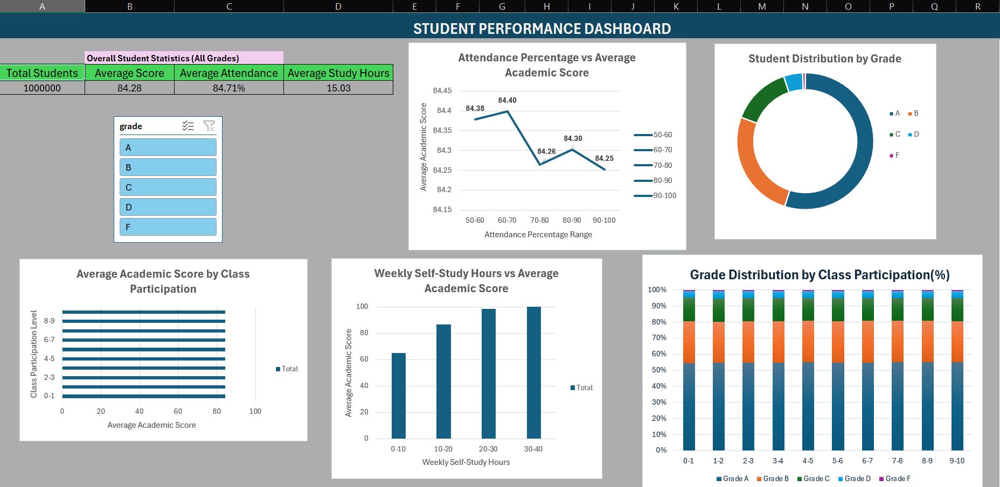

# Student Academic Performance Analysis

## Project Overview
This project focuses on analysing student academic performance using Microsoft Excel. The objective is to explore the dataset, identify patterns and understand factors associated with students' academic results.

## Tools & Technologies
- Microsoft Excel
- PivotTables
- PivotCharts
- Excel Formulas
- Interactive Slicers
- Data Visualization

## Project Objectives
- Analyse student academic performance.
- Explore the relationship between study hours and grades.
- Examine attendance patterns.
- Summarize data using PivotTables.
- Present findings through an interactive dashboard.

## Project Analysis
The project includes:
- Data analysis using PivotTables.
- Grade distribution analysis.
- Analysis of weekly self-study hours.
- Attendance-based performance analysis.
- Interactive visualizations and dashboard development.

## Dashboard Preview

## Project Documentation
The complete project documentation is available in the `Project_Documentation.pdf` file.

## Key Learning Outcomes
- Practical experience with Excel data analysis.
- Working with large datasets.
- Creating PivotTables and PivotCharts.
- Building interactive dashboards.
- Presenting analytical findings effectively.

## Conclusion
This project strengthened my practical Excel skills and helped me understand how raw data can be transformed into meaningful insights through data analysis and visualization.

## Download Excel Workbook

The complete Excel workbook used for this analysis is available here:

[View Student Performance Analysis Workbook](https://docs.google.com/spreadsheets/d/1L8XgaiOInfh_-EtwS3a6u1NuBJvE4OFP/edit?usp=sharing)
